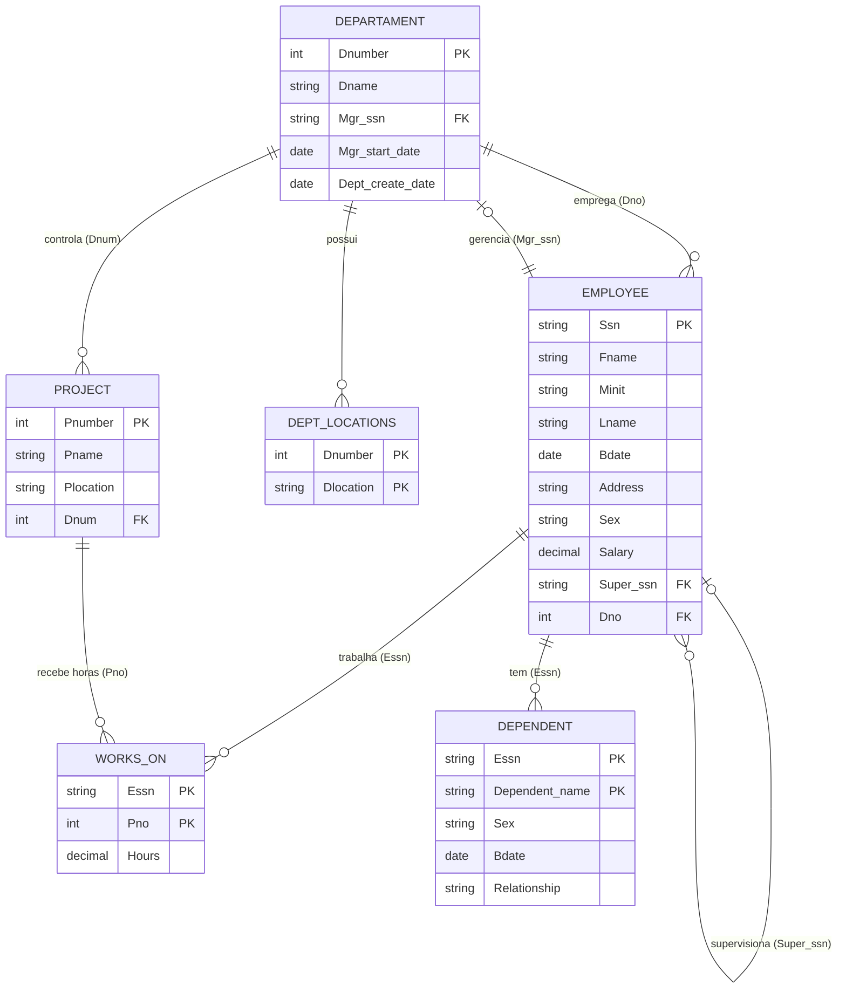

# 📊 Azure Company Dashboard


Projeto de Business Intelligence feito de ponta a ponta: banco de dados MySQL hospedado na **Microsoft Azure**, modelagem relacional, integração com o **Power BI**, medidas em **DAX** e um dashboard executivo de indicadores de **Recursos Humanos**.

## 🖼️ Dashboard


## 🎯 Perguntas de negócio respondidas

- Quantos colaboradores a empresa tem e como eles se distribuem por departamento e gênero?
- Quanto representa a **Folha Salarial** e qual a **Média Salarial** de cada departamento?
- Quantas horas cada projeto consome e quem está alocado em quê?
- Quantos dependentes os colaboradores têm, e de que tipo de relação?

## 🏗️ Arquitetura da solução

```
SQL Scripts (schema + dados + consultas)
        │
        ▼
Azure Database for MySQL
        │
        ▼
Power BI Desktop (modelagem + DAX)
        │
        ▼
Dashboard executivo de RH
```

## 🗂️ Modelo de dados

O banco segue o modelo relacional clássico **COMPANY**, usado em cursos de banco de dados, com 6 tabelas. Os dados são fictícios e servem para demonstrar a análise.



**Regras de integridade (no banco):** chaves primárias e estrangeiras em todas as tabelas, `CHECK` de salário mínimo, de sexo (`M`/`F`), de horas não negativas e de data de criação do departamento anterior à do gerente.

> **Notas do modelo**
> - A tabela de departamentos se chama `departament` (grafia original do projeto). O nome foi mantido para não quebrar o modelo do Power BI.
> - No Power BI, as tabelas aparecem com o prefixo do schema (por exemplo `azure_company employee`), que é o padrão do conector MySQL.

## 📁 Estrutura do repositório

```
Azure_company/
├── README.md
├── DB_Azure_company.pbix
├── SQL Scripts/
│   ├── 01 Azure company schema.sql      # banco, tabelas, constraints e dados
│   └── 02 azure company queries.sql    # consultas de análise e conferência
└── docs/
    └── dashboard.png
```

| Arquivo | O que contém |
|---|---|
| [`01 Azure company schema.sql`](SQL%20Scripts/01%20Azure%20company%20schema.sql) | Criação do schema, tabelas, chaves, `CHECK`s, carga de dados e conferência das constraints |
| [`02 azure company queries.sql`](SQL%20Scripts/02%20azure%20company%20queries.sql) | Indicadores do dashboard, perfil de colaboradores, hierarquia (inclui `WITH RECURSIVE`), projetos e horas, dependentes, qualidade de dados e views para o Power BI |

## 🚀 Como reproduzir

**Requisitos:** MySQL 8.0.16 ou superior (local ou Azure Database for MySQL), Power BI Desktop e, se o Power BI pedir, o *MySQL Connector/NET*.

1. Crie o servidor **Azure Database for MySQL** e libere o seu IP no firewall do servidor.
2. Execute o script `SQL Scripts/04_azure_company_schema_otimizado.sql`. Ele cria o schema `azure_company`, as tabelas e a carga de dados.
3. Confira a carga com a consulta de totais de controle (seção F do arquivo `05`). Valores esperados: **8 funcionários**, **folha de 281.000**, **3 departamentos**, **6 projetos** e **275 horas**.
4. No Power BI Desktop, use *Obter dados → Banco de dados MySQL*, informe o servidor e o banco `azure_company` e selecione as 6 tabelas.
5. Abra `DB_Azure_company.pbix`, atualize a origem de dados para o seu servidor (*Transformar dados → Configurações da fonte de dados*) e clique em **Atualizar**.
6. Confira os relacionamentos na visão de modelo.

## 📐 Medidas DAX

<!-- Conferir estas fórmulas com as medidas reais do arquivo .pbix antes de publicar -->

```DAX
Total Func  = COUNT ( 'azure_company employee'[Ssn] )

Total Folha = SUM ( 'azure_company employee'[Salary] )

Media Sal   = AVERAGE ( 'azure_company employee'[Salary] )
```

Coluna calculada na tabela de funcionários:

```DAX
Nome Completo =
'azure_company employee'[Fname] & " "
    & 'azure_company employee'[Minit] & ". "
    & 'azure_company employee'[Lname]
```

| Indicador | Origem |
|---|---|
| Total de Funcionários, Folha Salarial, Média Salarial | Medidas acima, filtradas pelo departamento no visual |
| Horas por Projeto | Soma de `works_on[Hours]` agrupada por projeto |
| Dependentes por Relação | Contagem de `dependent` por `Relationship` |

Cada indicador tem uma consulta SQL equivalente no arquivo `02`, útil para **validar** os números do dashboard.

## 🔍 Exemplos de insights

Os valores abaixo vêm do conjunto de dados de exemplo e são reproduzíveis com as consultas do arquivo `05`.

| Insight | Consulta |
|---|---|
| O departamento **Research** concentra **47,3%** da Folha Salarial (133.000 de 281.000) e metade dos colaboradores (4 de 8) | A4 |
| **Headquarters** tem a maior média salarial (55.000), mas com apenas 1 colaborador | A1 |
| **Newbenefits** e **Computerization** são os projetos que mais consomem horas (55 h cada, de 275 h no total) | D1 |
| **35 das 275 horas (12,7%)** são lançadas em projetos de outro departamento | D7 |
| Há **7 dependentes** (3 cônjuges, 2 filhos e 2 filhas), ligados a 3 colaboradores; 5 colaboradores não têm dependentes | E1, E2 |

## 🧩 Desafios resolvidos

- Integração entre **Azure Database for MySQL** e **Power BI**.
- Importação de tabelas vazias com **consultas SQL nativas**.
- Ajuste de **relacionamentos e cardinalidades**, incluindo direção de filtro.
- Correção de **caminhos ambíguos** no modelo de dados.
- Criação de **medidas e colunas calculadas** em DAX.
- Revisão do script SQL: remoção de FKs duplicadas com `DROP FOREIGN KEY` (sem a palavra-chave o MySQL tenta apagar uma coluna) e criação de uma FK que faltava entre funcionário e departamento.

## 🔒 Boas práticas e segurança

- Nenhuma senha ou string de conexão é versionada neste repositório.
- Recomendado: liberar no firewall do Azure apenas o IP necessário e exigir conexão SSL.
- Recomendado: usar um usuário do banco com permissão **somente de leitura** para o Power BI.

## 🧠 Competências demonstradas

- Modelagem de banco de dados e **SQL** (DDL, DML, consultas com `JOIN`, CTE, *window functions* e `WITH RECURSIVE`)
- **Microsoft Azure** (Azure Database for MySQL)
- **Power BI**, **DAX** e modelagem de dados
- ETL e Business Intelligence
- Visualização de dados e **qualidade de dados** (totais de controle e conferências)

## 🔭 Próximos passos

- Adicionar medidas de tempo no cargo e idade média por departamento.
- Criar uma página de projetos e alocação de horas no dashboard.
- Publicar o relatório no Power BI Service e agendar a atualização dos dados.

## 👤 Autor

**Felipe Luna**

📧 [LinkedIn](https://www.linkedin.com/in/felipe-luna-581377152/)
💻 [GitHub](https://github.com/Flip-data96)
